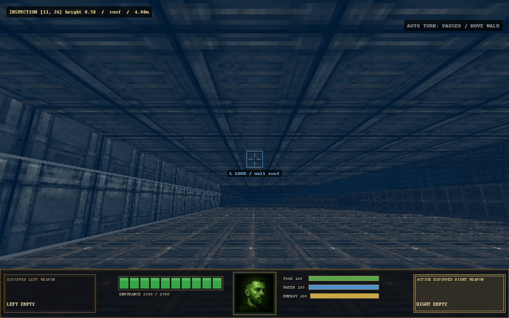
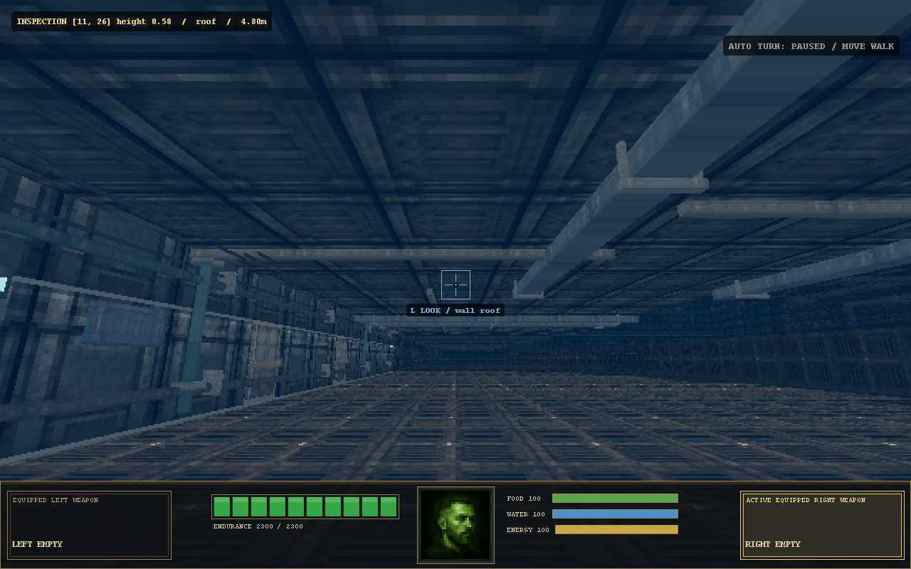
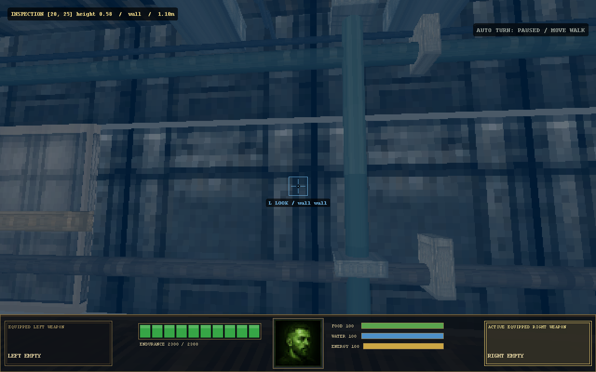
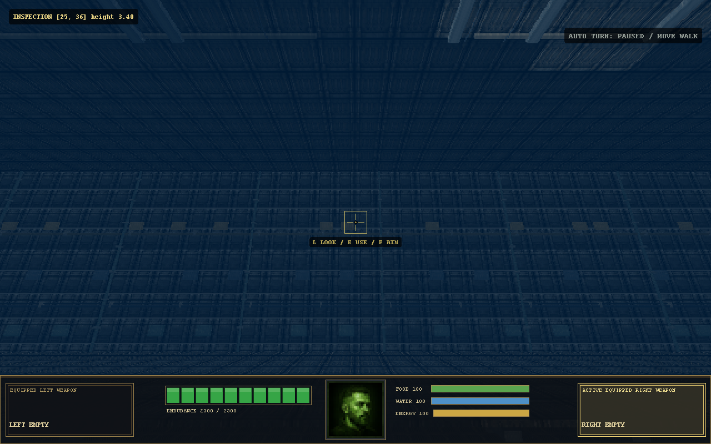
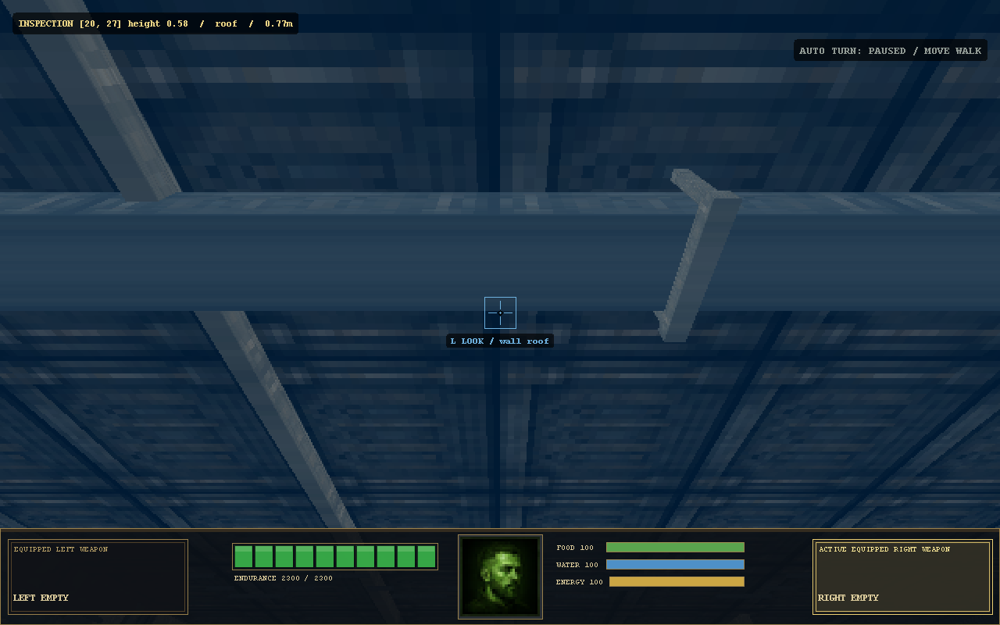
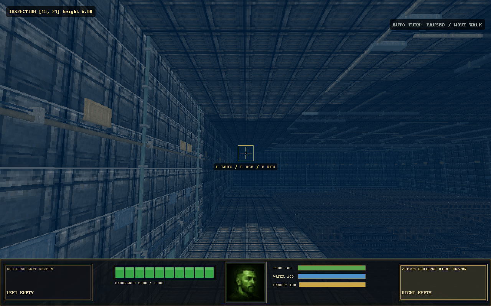
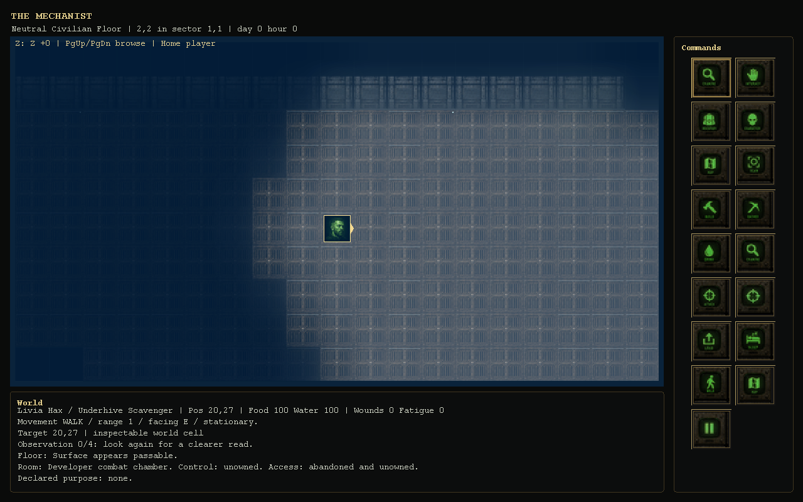
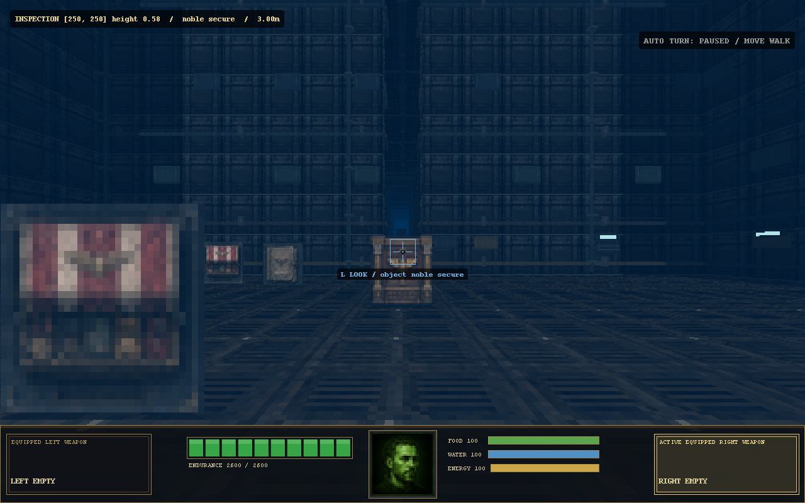
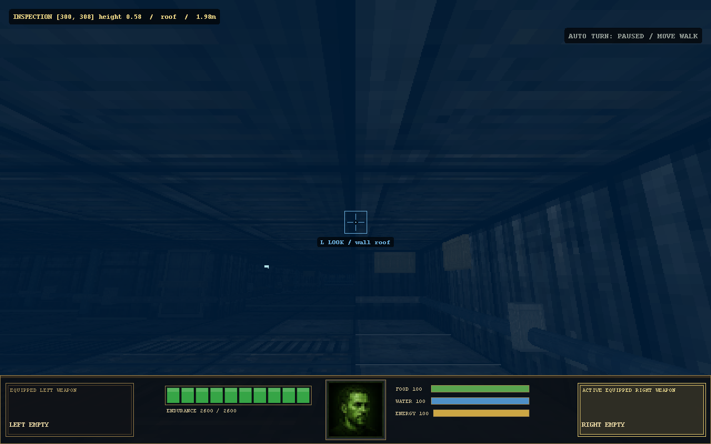

# Layered wall and underside clutter — 2026-11-02

Sixteen archived frames from the existing The Mechanist GamePanel and viewport: seven in the developer combat chamber and nine in the generated city. The geometry uses shipped wall and closed-door art. See the [system specification](../../docs/ARCHITECTURAL_CLUTTER.md) and [full HTML gallery](index.html).

## Matching aisle comparison

Same camera, roof layout and native art. The second frame adds the clutter recipe and its associated service lighting.

## Vertical history and underhang

Wall services sit in front of the actual wall geometry: round risers and pipe bands, later cable runs, patches, vents and permanently sealed door reliefs. Hanging ducts have physical yokes and supports. Small cable runs sag beneath the slab. Upper views use labeled inspection poses; these are not newly traversable storeys.

## Generated city

Seed 466713, main floor 4, 500×500, 930 rooms. The normal structural generation stages enable the same clutter recipe. Population/economy simulation is omitted for these architectural captures. The audit retains 33,997 open road/sidewalk/parking tiles and zero accidentally covered road tiles. All nine city frames are in the HTML gallery.

## Data and validation

- [Actual chamber piece inventory](clutter-pieces.tsv): 6,394 physical pieces, with feature, material generation, bounds, tint and native art glyph.
- [Capture seed/version and feature counts](capture-data.txt).
- [Facility poses](vantage-points.tsv), [city poses](city/vantage-points.tsv), and [city generation audit](city/generation-audit.txt).
- [Validation record](validation.txt) and [image SHA-256 checksums](SHA256SUMS.txt).

Use `/devroom battlemap clutter` in the existing facility. `multi`, `materials` or `flat` resets the clutter bay and its generated lights. Clutter geometry is enabled for newly generated normal zones; its recipe version persists with the world.

This is an initial architectural recipe using original geometry and existing textures. It does not add a salvage/electrical simulation, paid clutter construction, actual historic event replay, or completed stacked-storey occupancy. Dedicated sign/marking art, route junctions, detailed braces, abandoned storey scars and building-specific density/style tuning are recorded for follow-up. Ground routes stay clear; low-roof assemblies flatten to retain clearance above the existing character geometry.
