# Architecture, roofs, stairs and vertical viewport archive

2026-10-29. Captured through The Mechanist's existing `GamePanel` and first-person viewport using shipped artwork. Source checkpoints: `51a9f137` and `3c708f79`.

[Full HTML gallery](index.html) · [City generation audit](city/generation-audit.txt) · [Camera poses](city/vantage-points.tsv) · [Battle execution results](battle/results.txt)

The city uses seed **466713**, main floor **4**, and a **500×500** generated map: **930 rooms**, **8 stamped building rooms**, **33,997 open road tiles**, and **0 accidentally roofed road tiles**. Captures run the normal structural-generation stages; population/economy is omitted. Elevated cameras inspect real geometry and are labeled; they do not demonstrate reachable stacked storeys.

## Current city views

| Street and plaza | Roof inspection |
| --- | --- |
| 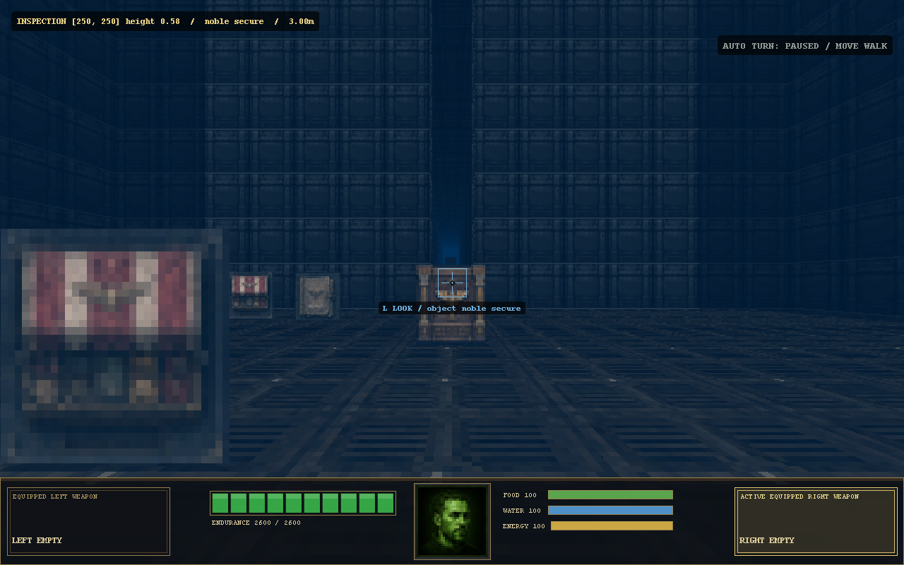 | 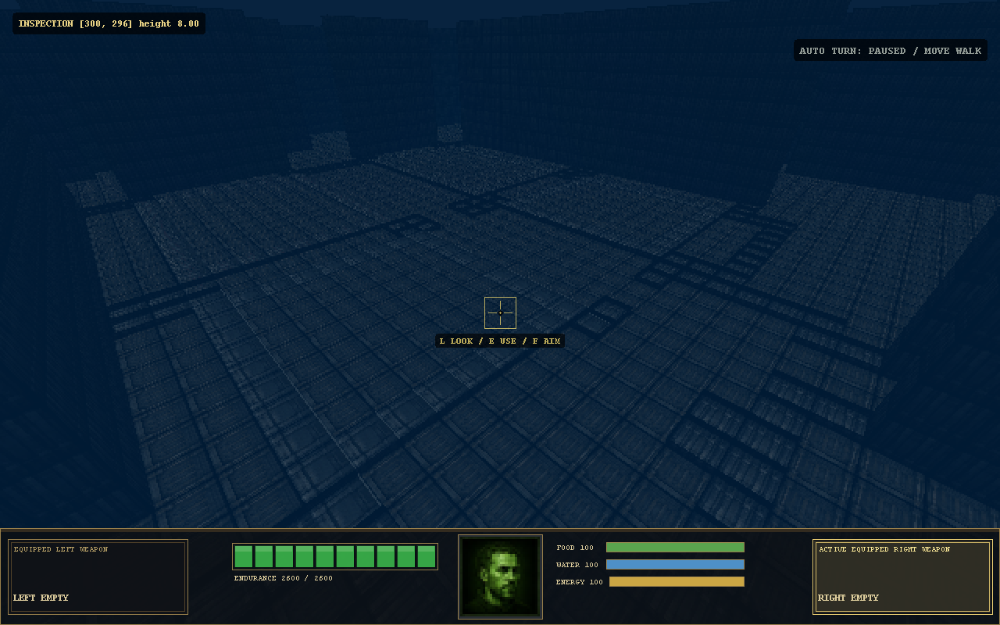 |
| 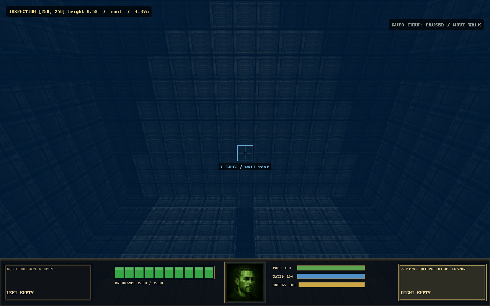 | 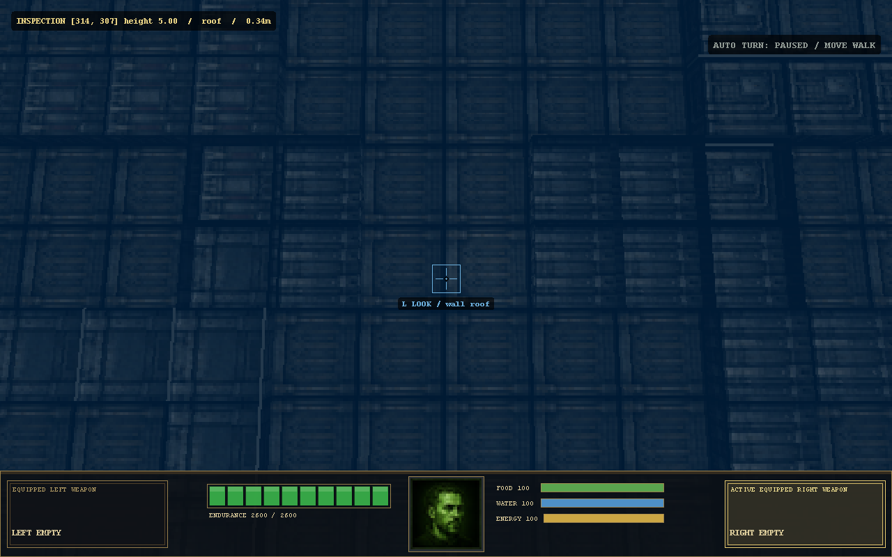 |
| 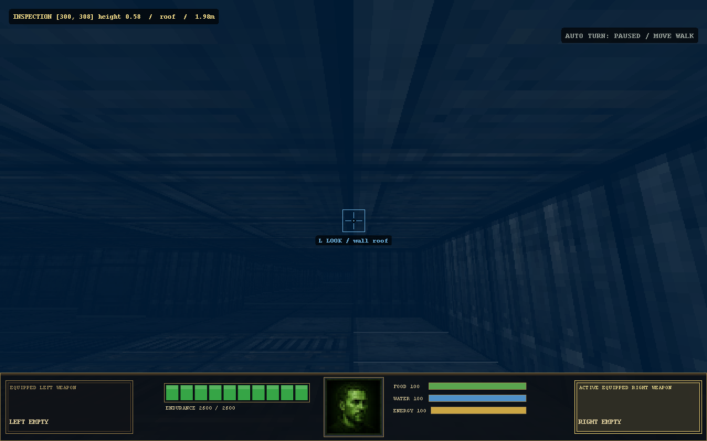 | 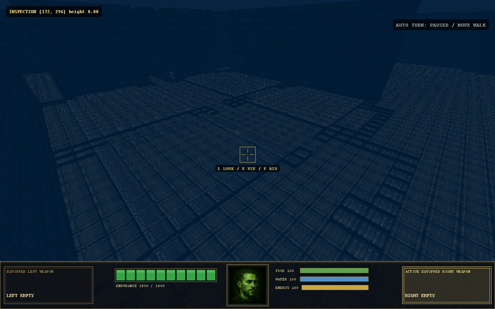 |

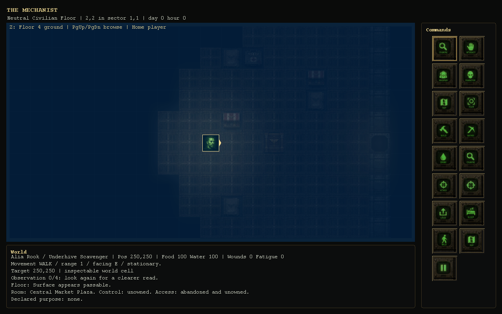

## Existing combat chamber

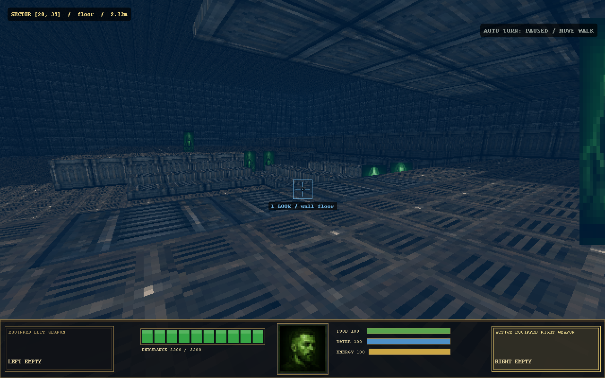

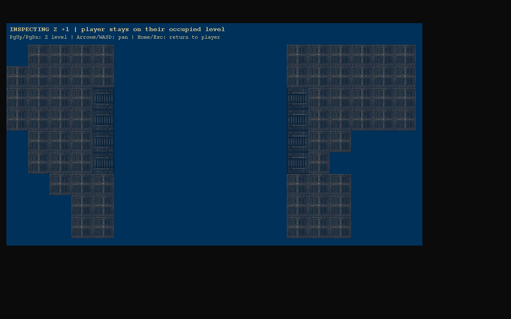

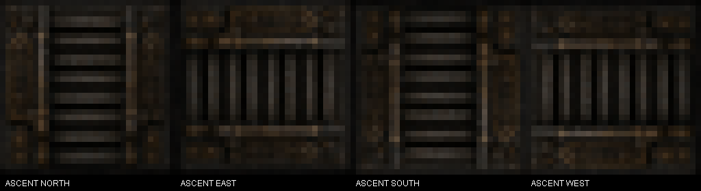

## Earlier pass retained for review

These earlier screenshots predate the final fog/door-height refinements; they are archival references, not a controlled fog-only comparison.

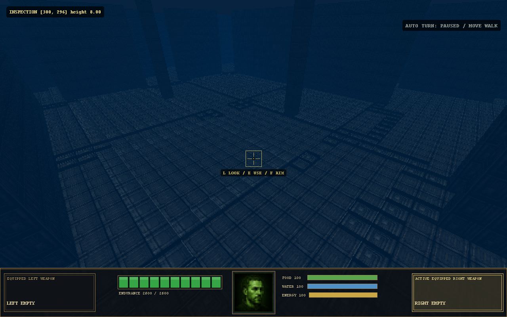

## Verified behavior

- Explicit roof coverage is independent of road/room surface type. Open streets/parks default unroofed; enclosed rooms default covered; explicit overrides persist.
- Generic walls span to the next main level. Authored building plates can replace that span; doors use local height.
- Roof panels use existing paid staged construction. The test builds fifteen walls, one door and nine roof tiles, verifies resource deductions and duplicate rejection, and places furniture below the roof.
- Z-level browsing does not move the player or change atlas coordinates. Stair art rotates with authored ascent direction.
- Darkness exposure bottoms out at #001a33. Fog starts at 12 tiles and fades gradually to 96; geometry traces reach 120.
- Passing checks: `TileStructureSmoke`, `RoofConstructionSmoke`, `ViewportFogSmoke`, `DeveloperBattleMapSmoke`, `ActorCombatExecutionSmoke`, `Milestone02DoomHudFacingSmoke`, `MultiFloorBuildingPlacementSmoke`, `MultiFloorBuildingTransitSmoke`; full Java 17 compilation.

## Remaining work

Local room-over-room storeys and their occupancy/visibility model remain unfinished. Current building blueprints connect main atlas levels, which must be distinguished from building storeys. Height-based material and weathering variation is recorded in [the architecture backlog](../../docs/ARCHITECTURE_DEVELOPMENT_BACKLOG.md), per the user's request.

No standalone demo renderer or placeholder-character prototype is included in this archive.
