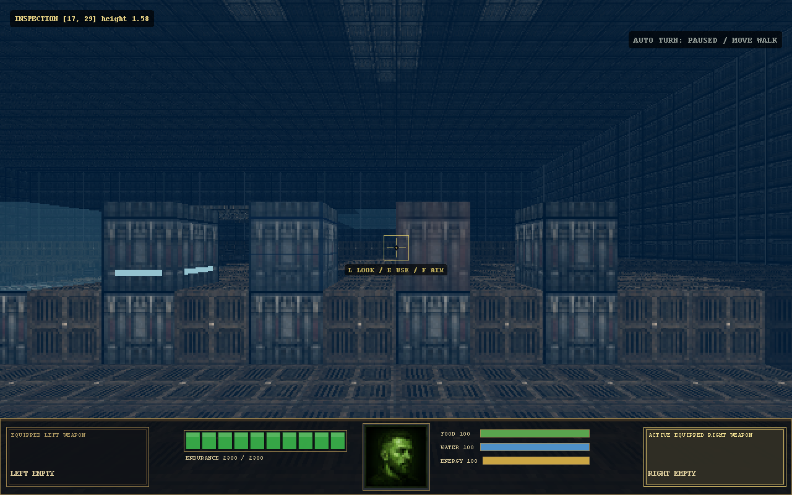
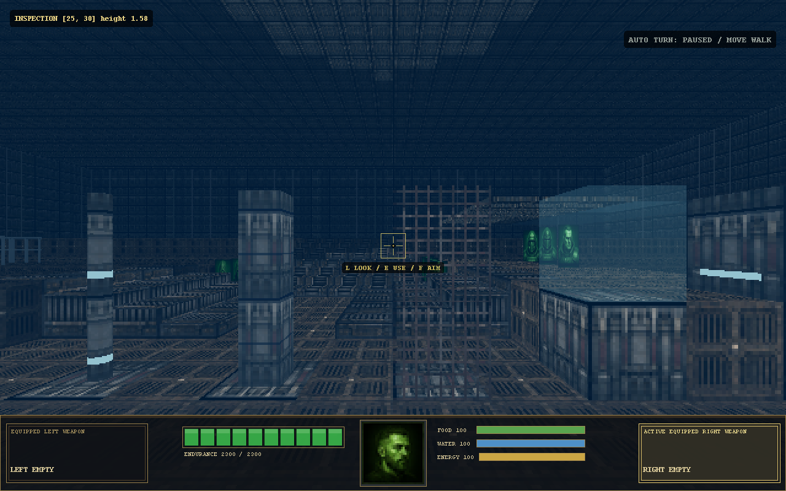
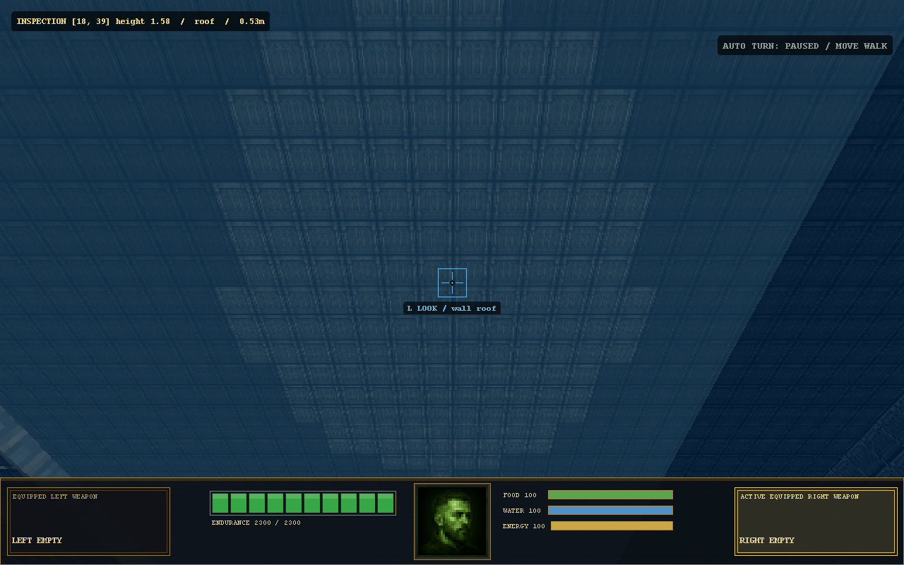
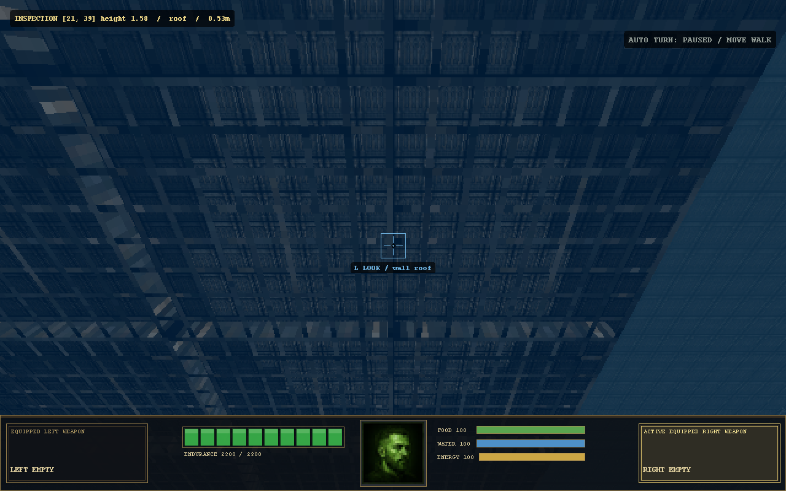
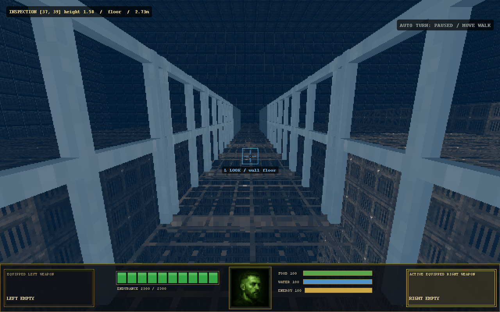
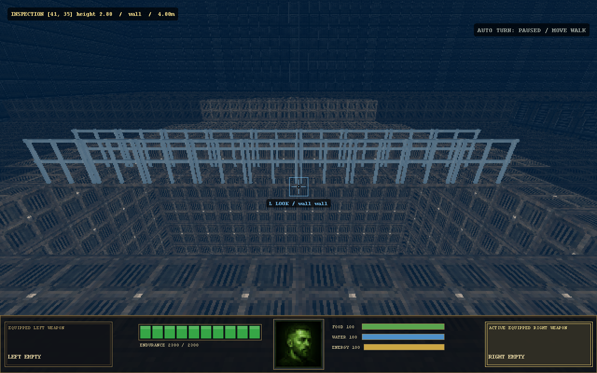
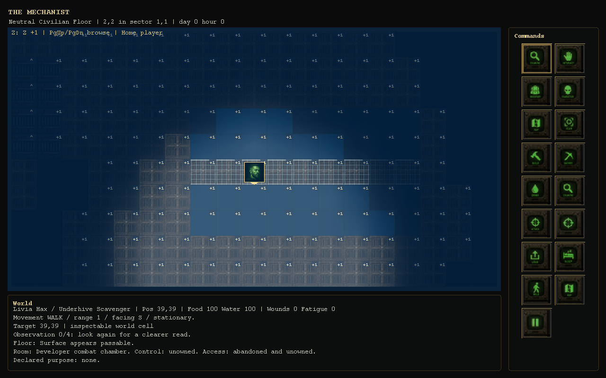

# Structure materials and guarded catwalks — 2026-11-02

Seven archival frames from the existing The Mechanist developer combat chamber, captured through `GamePanel.paint` and `FirstPersonRenderViewport`, with the game's shipped tile and character art. No separate renderer or world was created. See the [complete system specification](../../docs/STRUCTURE_MATERIALS_AND_CATWALKS.md) and [HTML gallery](index.html).

Use `/devroom battlemap materials` in the existing developer facility. The seed is 233306817; the combat preset is rifles, ten actors per team, combat seed 71000. Inspection cameras include elevated poses, explicitly labeled in first-person frames. The normal view remains the 2D planner.

## Walls and finishes

Plain, stained, paneled and lit native wall surfaces. The neighboring bay contains translucent glass, perforated grating, square pillars and round pipes. The native character portraits remain visible through optical openings.

## Canopies

Glass reveals the textured concrete underside of the next main level through a blue tint. Grating adds actual opaque bars and open apertures. The shared distant underside remains concrete above both materials.

## Catwalks and normal planner

The grating walkway supports actors; the surrounding VOID tiles do not. Side railings block crossings from both directions while leaving views between posts and bars open. The oblique view is an elevated inspection camera, not a reachable extra storey.

## Recorded data and checks

- [Actual authored material tiles](material-tiles.tsv): ground height, glyph, roof, clearance, wall top, wall form/finish, floor support and railing mask.
- [Construction costs exported from BuildRecipe](construction-costs.tsv).
- [Camera poses](vantage-points.tsv) and [capture metadata](capture-metadata.properties).
- [Validation record](validation.txt) and [PNG SHA-256 checksums](SHA256SUMS.txt).

This is an authored material capability and developer test bay. Procedural city distribution, height-based facade bands, local stacked-storey occupancy, paid catwalk/railing tools, glass destruction, jumping and fall damage remain follow-up work. Normal movement refuses unsupported steps. Pillar and pipe tiles retain full-cell actor collision; their view silhouettes are narrower. The planner uses cell-level sight approximation, while first-person rays resolve physical geometry.
